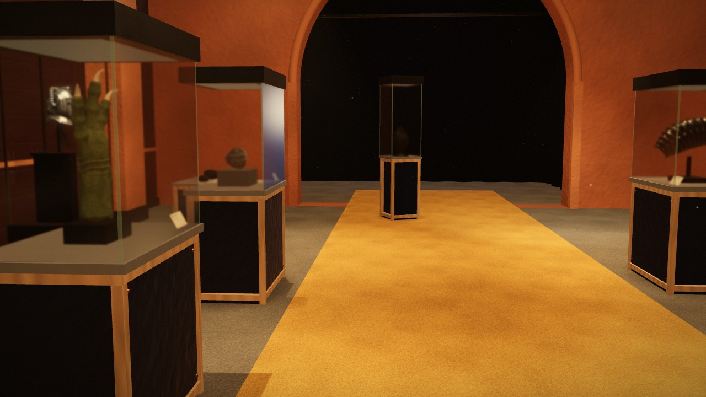
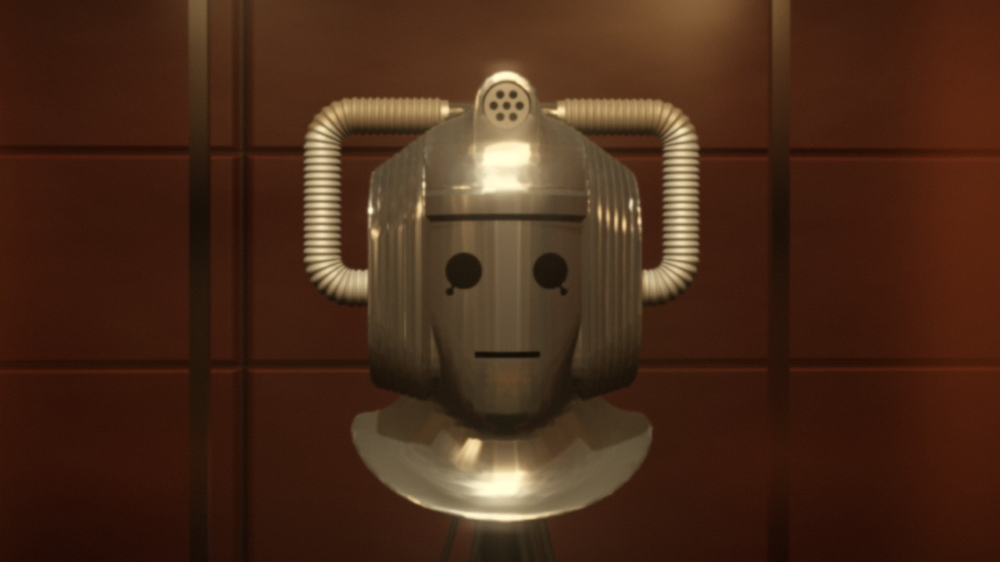
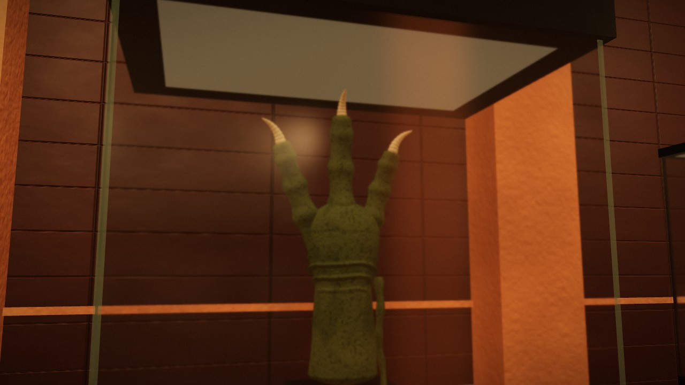
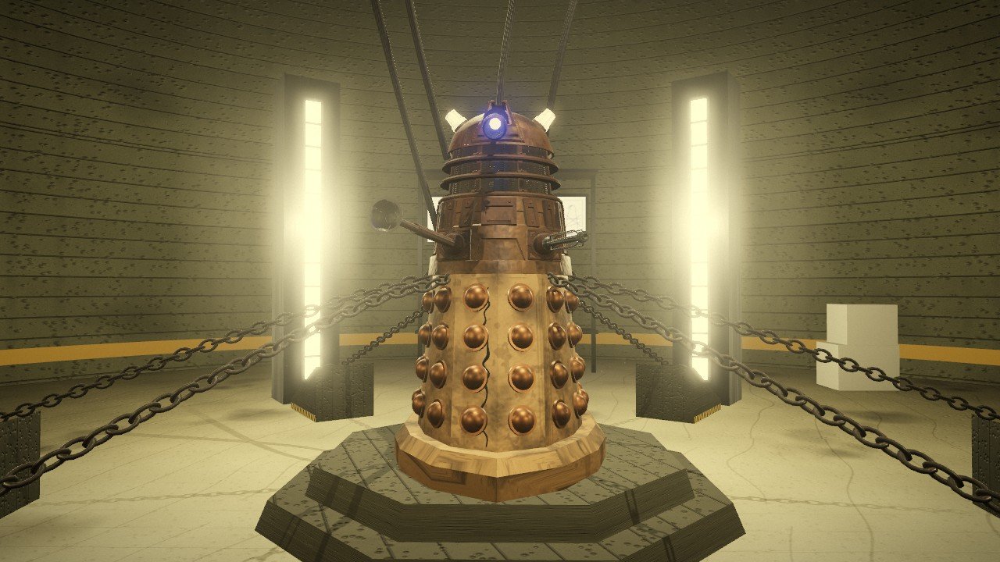
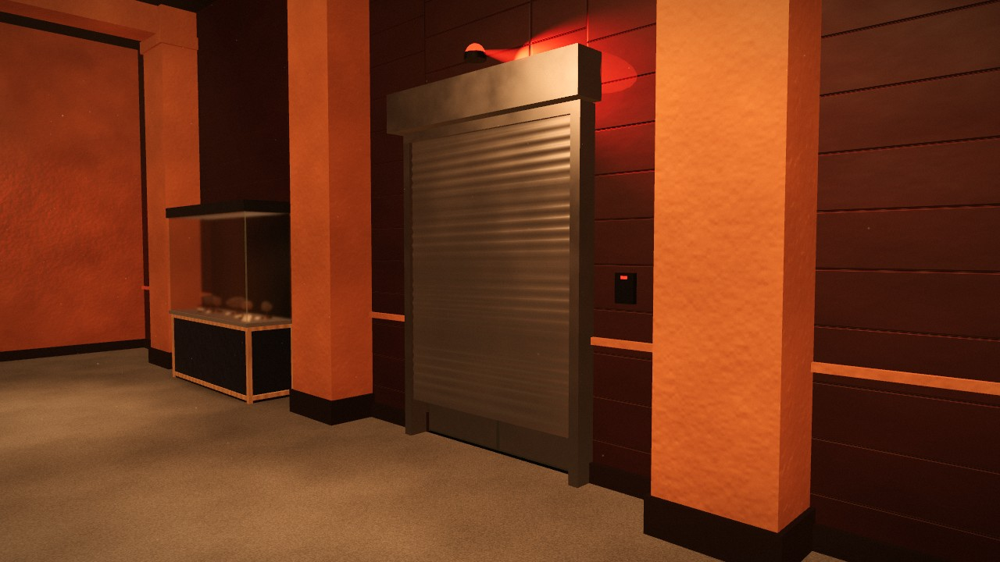
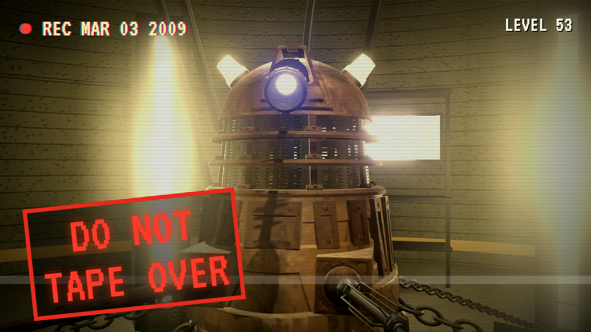

# The Vault

**An interactive 3D reconstruction of Henry van Statten's private alien museum, and the Dalek's cell beneath it, from *Doctor Who* "Dalek" (2005).**

▶ **Explore it in your browser: https://greencat667.github.io/van-statten-vault/**

It's one self-contained HTML file. It runs offline, needs no install and builds everything at start-up with Three.js.

- **The exhibit room.** Its layout was fitted to the episode's wide shot by solving the camera from points measured in the frame. It has the mustard runner, orange pilasters, terracotta bays, navy and beech vitrines, and the arch.
- **The collection.**
  - Seen on screen: the Revenge of the Cybermen head, the stuffed Slitheen arm, the meteorite, the ribbed specimen, the egg and a primate head.
  - Named in dialogue: moon dust, the Roswell milometer and weapons.
  - Every exhibit has an inspection view and documentation that separates screen-confirmed facts from inference and speculation.
- **The Cage.** The 2005 bronze Dalek, battle-damaged and chained, among its light pillars. Its colours were sampled from BBC stills.
- **Things to do:** walk with WASD and the mouse, inspect exhibits, take the guided tour, switch the lights on, touch the Cyberman's case to trip the alarm and seal the room, view a floor plan coloured by evidence, and toggle an "Expanded Vault" of imaginative additions.

| | |
|---|---|
|  |  |
|  |  |

## The film: *Level 53 Orientation*

A short found-footage fan film shot inside the Vault: a Geocomtex induction tape, recorded the night before "Dalek", over a tape that should not have been reused. It's on the [Machine Matinee](https://www.youtube.com/@MachineMatinee) YouTube channel.

The film was captured frame by frame from the app's `?film` mode (`video/scripts/capture.mjs`, Playwright) and edited in Remotion (`video/src`), with a VHS-on-CRT finish. All sound and music is synthesised; the voices are Kokoro.

## Building

`index.html` is the built app. The source is in `src/`. `node build.mjs` bundles it with esbuild into one file, inlining three.js r180 and the mesh packs.

**The mesh packs (`assets/*.bin`) are not in this repo.** The TARDIS model's licence forbids redistributing the model file on its own, so none of the packs are published separately. To rebuild, download the meshes below and pack them with the Blender scripts in `tools/` (`blender -b --factory-startup -P tools/<script>.py -- <in.stl> <out.bin> …`).

## Credits and licences

- **Cyberman helmet body:** "Classic Cyberman Helmet" by ZacharyAnnese, [Thingiverse 6839144](https://www.thingiverse.com/thing:6839144), CC BY-SA. Decimated; the handles and lamp were rebuilt to match the episode.
- **Dalek:** "Dalek model – Doctor Who 2005 series" by rsfuhrer, [Printables 12372](https://www.printables.com/model/12372-dalek-model-doctor-who-2005-series), **CC BY-NC-SA 4.0**.
- **TARDIS:** "TARDIS 2005 model A/B", [CGTrader](https://www.cgtrader.com/free-3d-models/aircraft/other/tardis-2005-model-a-b), Royalty Free licence.
- **Three.js:** MIT.
- **Code** in this repository (`src/`, `video/`, `tools/`, `build.mjs`): MIT.
- **The built app (`index.html`) and the film:** CC BY-NC-SA 4.0, because they include the share-alike, non-commercial Dalek model. Non-commercial use only.

This is an unofficial, non-commercial fan project. *Doctor Who*, the Daleks, the Cybermen, the Slitheen and the TARDIS are © BBC. "Dalek" was written by Robert Shearman.
